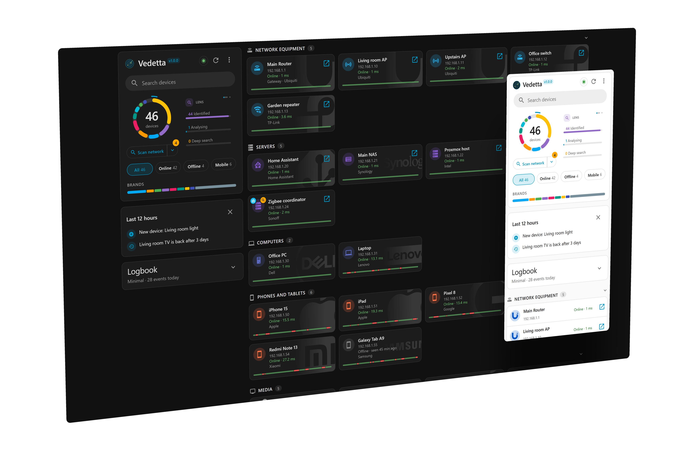
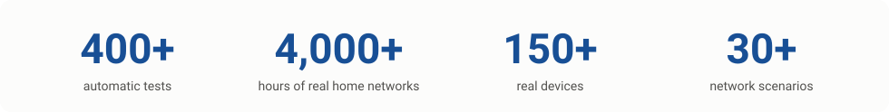

<picture><source media="(prefers-color-scheme: dark)" srcset="docs/images/radar-dark.svg"></picture>

**The Home Assistant app that finds and follows every device on your network and your VLANs, and tells your phone when one goes away.**

    

## See it

Tiles or list · light or dark · computer or phone · <a href="https://sived80.github.io/vedetta/">Live demo</a>, 46 household devices, nothing to install

Also inside: sleeping phones remembered · each device's own web page, one tap away · three search levels, you choose the risk · your device list as CSV or JSON · Home Assistant events and optional MQTT. [How it works](docs/HOW_IT_WORKS.md)

## Tested

<picture><source media="(prefers-color-scheme: dark)" srcset="docs/images/testing-numbers-dark.svg"></picture>

Real exports replayed and a virtual LAN, every release. Images built and signed on GitHub, checkable by anyone. [How](docs/TESTING.md)

## How it recognizes a device

Many weak clues, weighed together. A repeated fact counts once.

Sources, weights and certainty bars, all in the open: [Recognition](docs/RECOGNITION.md).

## What it does

**Every network, every VLAN.** The networks behind your router, tried before you add them, checked every 15 minutes.

**Your phone knows first.** When a device goes away, and when it is back. Never a "back" without a real "gone".

**30 days of memory.** Presence, link quality and the names each device had. The last 12 hours at a glance.

**It follows the device, not the address.** A new address or a new private MAC: still the same card.

**A doctor for your network.** Duplicate addresses, drops, restarts, a slow router.

**It watches, never touches.** It never logs in to a device and never tries a password.

And of course it names every device: name, brand, model and type, with every clue in the open. [How it recognizes a device](#how-it-recognizes-a-device)

## Install

> [!IMPORTANT]
> **Give it a day or two**: phones sleep and names are announced now and then. [Why](docs/TROUBLESHOOTING.md)

> [!NOTE]
> Needs **Home Assistant OS** or **Supervised**. *Container* and *Core* have no App store.

**1. Add** the repository, or add `https://github.com/Sived80/vedetta` by hand in the App store. 

**2. Install**: find **Vedetta** in the App store. 
**3. Start**: press **Start**, then **Scan network**. [Step by step](docs/INSTALLATION.md)

**A device is wrong or unknown?** Every report becomes a fix, and you can [teach it a device](docs/DEVELOPMENT.md). 

**Free and open source, and it stays that way.** A coffee keeps it going. 

⭐ Names your devices right? A star helps others find it. *Watch › Custom › Releases* tells you about new versions.

## Automations

Turn on *Events in Home Assistant* (Menu → Alerts), then import a ready-made blueprint. Each event carries name, address, brand and type: [Home Assistant](docs/HOME_ASSISTANT.md).

**New device on the network** 

**Device went offline** (and back) 

## Docs

**Start** · [Installation](docs/INSTALLATION.md) · [How it works](docs/HOW_IT_WORKS.md) · [Troubleshooting](docs/TROUBLESHOOTING.md) 
**Inside** · [Recognition](docs/RECOGNITION.md) · [Networks and VLANs](docs/NETWORKS.md) · [Network doctor](docs/NETWORK_DOCTOR.md) · [Home Assistant](docs/HOME_ASSISTANT.md) · [MQTT](docs/MQTT.md) 
**About** · [Privacy](docs/PRIVACY.md) · [Roadmap](docs/ROADMAP.md) · [How it is tested](docs/TESTING.md) · [Development](docs/DEVELOPMENT.md) · [Changelog](vedetta/CHANGELOG.md)

## Your language?

English · Italiano · Deutsch · Čeština (thanks to the community). Adding yours takes no code: copy the `en` folder. [How](docs/DEVELOPMENT.md#add-a-language)

## License and credits

[MIT License](LICENSE). Everything it builds on, with its license: [THIRD_PARTY_NOTICES](THIRD_PARTY_NOTICES.md). Nmap and arp-scan are installed from Alpine on your Home Assistant when the app starts, not shipped here. MAC vendors from the IEEE registries, icons from Material Design Icons. Brand names only describe devices; not affiliated with any of them.
