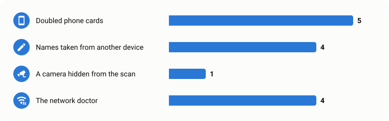

# How Vedetta is tested

Vedetta looks at your home network, so a mistake is a wrong name on a card, or worse, an alarm about a problem that is not there. This page shows how a change is checked before it reaches you, with the numbers of the last release.

[← Back to the README](../README.md)

<picture><source media="(prefers-color-scheme: dark)" srcset="images/testing-numbers-dark.svg"></picture>

## The way of a change

<picture><source media="(prefers-color-scheme: dark)" srcset="images/testing-pipeline-dark.svg"></picture>

### The virtual LAN, by problem

<picture><source media="(prefers-color-scheme: dark)" srcset="images/testing-scenarios-dark.svg"></picture>

## An example: the network doctor of 0.11.0

Before switching the doctor on for everyone, its checks were replayed on every export we had.

<picture><source media="(prefers-color-scheme: dark)" srcset="images/testing-before-after-dark.svg"></picture>

The replay caught a mistake before it reached anyone: almost every "device that restarts again and again" was just a **phone** going to sleep. Phones are now left out.

And the other way round: real faults must still be caught. They were added to real history and played on the virtual LAN.

<picture><source media="(prefers-color-scheme: dark)" srcset="images/testing-detection-dark.svg"></picture>

Run it yourself: `python tools/gate.py` · `python tools/replay_health_engine.py export.zip` · `python3 tools/lansim/run_campaign.py --out results.jsonl`

Found something these tests missed? [Open an issue](https://github.com/Sived80/vedetta/issues/new/choose): it becomes a new test.
