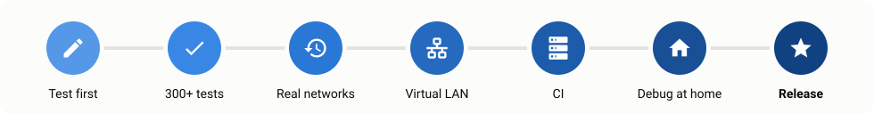
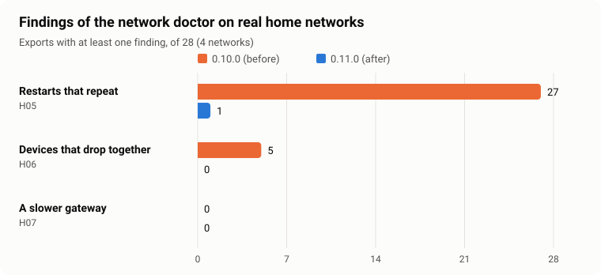
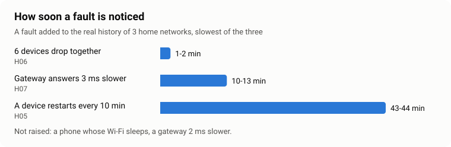

# How Vedetta is tested

Vedetta looks at your home network, so a mistake is a wrong name on a card, or worse, an alarm about a problem that is not there. This page shows how a change is checked before it reaches you, with the numbers of the last release.

[← Back to the README](../README.md)

## The way of a change

<picture><source media="(prefers-color-scheme: dark)" srcset="images/testing-pipeline-dark.svg"></picture>

- **Test written first.** A bug or a new rule starts as a test that fails; the code comes after.
- **326 automatic tests** run before every change is kept (`python tools/gate.py`): the server, the recognition, the page itself (built and clicked through in Italian, English and German), and no function may grow more complex than the ones before it.
- **Real exports replayed.** People who use Vedetta share an export of their network (masked, or encrypted for the author only). The new code reads the same history as the old one and the results are compared, rule by rule. No export is kept in the repository.
- **Virtual LAN.** A small network made of Linux namespaces: a router, Wi-Fi extenders, phones, plugs, cameras, and the real Vedetta looking at them. It reproduces what is hard to catch at home: two devices on one address, devices that drop together, a device that restarts, a gateway that slows down. It is in the repository (`tools/lansim`), so anyone can run it.
- **CI on Linux**, and the **debug app**: a second copy of Vedetta next to the real one on a home Home Assistant, where a release candidate runs for real.

## An example: the network doctor of 0.11.0

The doctor had been running quietly, visible only in the debug mode, since 0.9.0. Before switching it on for everyone, its four checks were replayed on every export we had, one judgment every two minutes, as the app does.

<picture><source media="(prefers-color-scheme: dark)" srcset="images/testing-before-after-dark.svg"></picture>

| Check | 0.10.0 (before) | 0.11.0 (after) |
|---|---|---|
| Restarts that repeat (H05) | 27 of 28 exports | 1 of 28 |
| Devices that drop together (H06) | 5 of 28 | 0 of 28 |
| A slower gateway (H07) | 0 of 28 | 0 of 28 |

The replay found a mistake before it reached anyone: almost every "device that restarts again and again" was a **phone** whose Wi-Fi sleeps at a nearly regular pace. In 0.11.0 the checks on drops leave phones out, and count only devices that have a card. What is left is one battery doorbell, for half an hour, on one network.

A check that never speaks is no better than one that speaks too much, so the opposite was tested too: a fault was added to the real history of three networks, and the virtual LAN played the same faults with the real app.

<picture><source media="(prefers-color-scheme: dark)" srcset="images/testing-detection-dark.svg"></picture>

| Fault added | Raised after |
|---|---|
| 6 devices drop together | 1-2 min |
| The gateway answers 3 ms slower | 10-13 min |
| A device restarts every 10 minutes | 43-44 min |
| A phone whose Wi-Fi sleeps · a gateway 2 ms slower | not raised (on purpose) |

## Run it yourself

| What | Command |
|---|---|
| All the tests | `python tools/gate.py` |
| The doctor on your own exports | `python tools/replay_health_engine.py export.zip` (add `--inject periodic:600:8`, `together:6` or `step:3` for a fault) |
| The virtual LAN (Linux, root) | `python3 tools/lansim/run_scenarios.py --code-dir vedetta --scenario S15` |
| The pictures of this page | `python tools/make_testing_charts.py` |

Found something these tests missed? [Open an issue](https://github.com/Sived80/vedetta/issues/new/choose): it becomes a new test.
